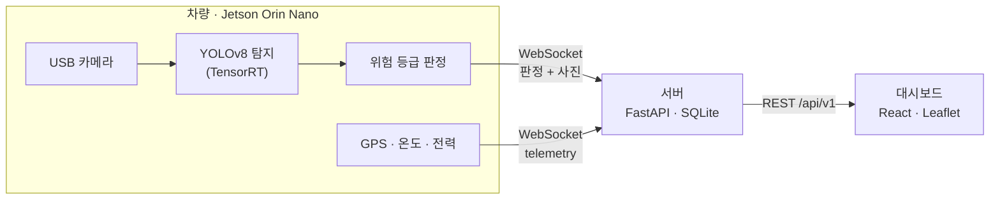

<picture>
  <source media="(prefers-color-scheme: dark)" srcset="https://raw.githubusercontent.com/DSM-Hail-mary/.github/main/profile/assets/hailmary-logo-dark.png">
  
</picture>

### 차량 탑재 엣지 AI로 전주 위 까치집을 찾아내는 배전설비 점검 시스템

---

## 소개

**HailMary**는 차량에 단 카메라와 Jetson으로 주행 중 전주 상단을 촬영하고,
까치집 같은 위험물을 **온디바이스로 탐지·판정**합니다. 판정 결과(등급 + 사진 + GPS)와 기기 상태는
서버로 전송되고, 사무실에서는 지도 대시보드로 위치를 확인하고 검수·처리 상태를 관리합니다.

- **현장에서 바로 판정** — 영상을 올리지 않고 엣지에서 탐지·판정까지 끝내 대역폭과 서버 부하를 줄입니다.
- **끊겨도 잃지 않음** — 네트워크가 끊기면 오프라인 버퍼에 쌓았다가 재연결 시 순서대로 전송합니다.
- **검수까지 한 곳에서** — 지도·목록에서 위험 전주를 찾고, 크롭 사진으로 판정을 검수합니다.

## 동작 흐름

| 등급 | 의미 |
|:---:|---|
| 🔴 **위험** | 까치집이 확실하게 검출됨 — 처리 대상 |
| 🟡 **주의** | 검출 신뢰도가 경계 구간 — 확인 필요 |
| 🟢 **양호** | 이상 없음 |

## 레포지토리

| 레포 | 설명 | 스택 |
|---|---|---|
| [**Hail-mary-main**](https://github.com/DSM-Hail-mary/Hail-mary-main) | Jetson 엣지: GStreamer + DeepStream 탐지·판정 + `edge/` 서버 전송·GPS·기기 지표 (구 Hail-mary-Camera 통합) | C++ · DeepStream · Python |
| [**Hail-mary-Server**](https://github.com/DSM-Hail-mary/Hail-mary-Server) | 엣지 수신(WebSocket)과 대시보드용 REST API | FastAPI · SQLite |
| [**Hail-mary-Front**](https://github.com/DSM-Hail-mary/Hail-mary-Front) | 전주 위험 지도 대시보드 | React · TypeScript · Leaflet |

DSM · HailMary Team

